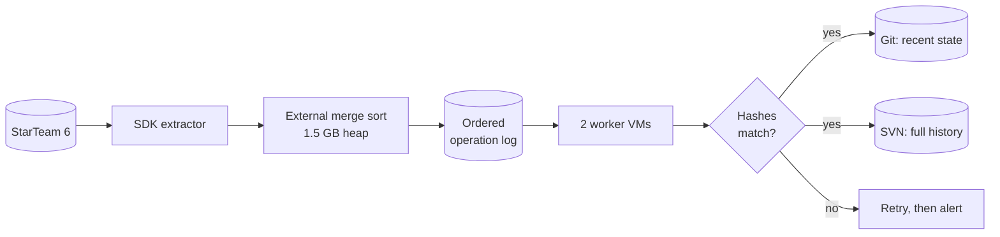
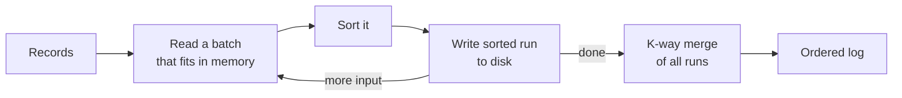

At Novatek, an end-of-life version control system held 20+ years of development history: 700K+ commits across 200K+ files. The vendor was gone, the SDK had almost no documentation, and there was no clean snapshot to fall back on. The history had to come out with zero data loss. I did it without AI help, just the SDK, the compiler, and small experiments.

**Stack:** Java 8 · StarTeam SDK/CLI · SVN CLI · Git · Batch

## The constraints

- **End-of-life system:** StarTeam 6, support ended in 2015, built for Windows XP and running on Windows 11, at its capacity limits.
- **No help:** no migration tool, no vendor support, a 32-bit Java 8 SDK with minimal docs.
- **Hard ceiling:** about 1.5 GB of JVM heap, which a 32-bit JVM can't raise.
- **Requirement:** every commit, version, tag and piece of metadata. Zero loss, and proven.

Together they ruled out the obvious design: load all history, sort it, replay it.

## Start small, then grow

I broke the problem into questions and answered each on a small slice first:

1. **Can I read the data?** Pull the history of one small section through the SDK.
2. **Can I rebuild it?** Replay it into a test repository and compare against the source.
3. **Does it survive bad input?** Fix UTF-8 messages, null fields and empty commits as they appear.
4. **Does it scale?** Grow until the biggest repositories hit the 1.5 GB ceiling.
5. **Full run:** two VMs in parallel, with alerts on failure.

Every new problem showed up where it was still cheap to understand.

## The pipeline



Extraction, ordering and replay are separate stages, so each can be re-run and checked on its own. Nothing counts as done until it's hashed, and failures stop and alert instead of being skipped.

## Reverse-engineering the SDK

I learned the SDK's object model by experiment: which classes expose item history, how revisions are enumerated, what a "view" returns versus a "folder". Write a tiny program, call one method, print everything it returns, take notes.

The key finding: the SDK could read the full history of every item, without touching the database directly.

## Why external merge sort

StarTeam stores history per file. Git and SVN need one ordered stream of changes. And the SDK's `history()` call returned each file's revisions out of chronological order, so replaying them as-is would have produced the wrong history.

So I converted every record's date and timezone into a single Unix timestamp, including tags, and sorted everything on it. For the large repositories those records didn't fit in 1.5 GB, so the sort had to work in batches:



```java
// Phase 1: sorted runs that fit the heap
List<File> runs = new ArrayList<>();
while (input.hasNext()) {
    List<Op> batch = input.readUpTo(BATCH_SIZE);
    batch.sort(BY_TIMESTAMP);
    runs.add(writeRun(batch));
}

// Phase 2: k-way merge
PriorityQueue<RunCursor> heap = new PriorityQueue<>(BY_HEAD_TIMESTAMP);
for (File run : runs) heap.add(new RunCursor(run));
while (!heap.isEmpty()) {
    RunCursor c = heap.poll();
    output.write(c.head());
    if (c.advance()) heap.add(c);
}
```

| | In-memory sort | External merge sort |
|---|---|---|
| Memory | O(n) | O(batch size + runs) |
| Works under a hard heap cap | no | yes |

Memory depends on the batch size, not the size of the repository.

## Proving zero data loss

- **Hash every file at every commit,** at the source and at the target, so a bad copy is caught where it happens.
- **Compare tags** between source and target. The counts had to match.
- **Flag duplicates:** if two tags resolved to the same hash, it went to review instead of passing silently.

Git got the recent state for day-to-day work, and SVN kept the full 20-year history and tags as the archive. That split was the company's call, and the pipeline served both.

## What I took away

1. **Size the algorithm to the memory you have.** If the heap can't grow, work in bounded batches.
2. **Verify every transfer.** A repository that opens isn't proof the history is right.
3. **Small slices make hard problems tractable.** Solve a tiny version, understand it, then grow.

It was slower than asking an assistant, but by the end I understood every part of the system, and that's why I could fix the edge cases and design the memory workaround myself.
